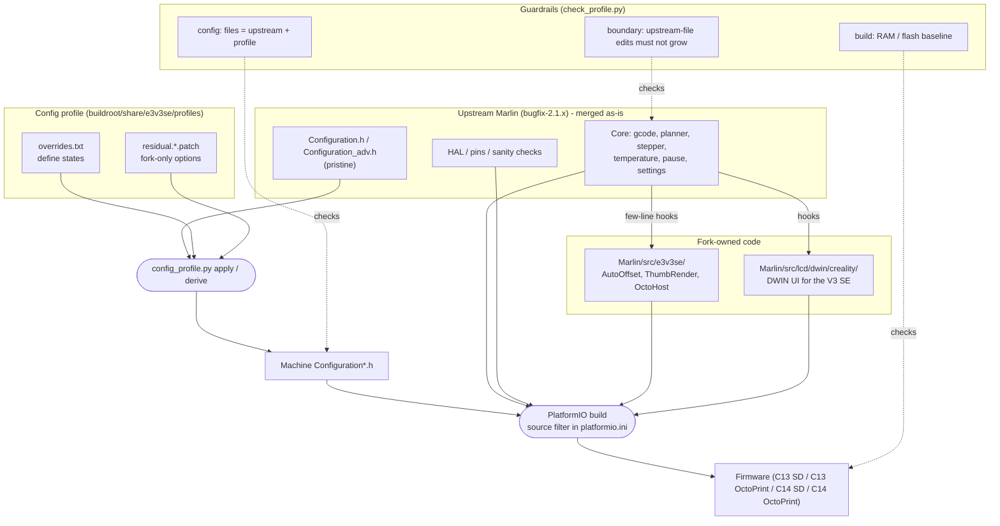

# Marlin for the Creality Ender-3 V3 SE

An upstream-first Marlin 2.1.x bugfix fork for the **Creality Ender-3 V3 SE**.

The goal of this repository is simple: **pull upstream Marlin at any time without regressions**. All fork-specific behavior is isolated behind a small, auditable boundary, and the machine configuration is generated from pristine upstream files plus a reviewed profile.

> Status: this is the `c14_octoprint` branch (C14, OctoPrint host). It builds for STM32F401RE and is awaiting printer validation. Profile-default builds use 29,336 B RAM / 232,896 B flash; the GitHub Actions default dispatch enables additional DWIN menu options and builds to 29,360 B RAM / 238,240 B flash. Changing dispatch options changes the size.

## Table of Contents

- [Why this architecture](#why-this-architecture)
- [Branches](#branches)
- [Project structure](#project-structure)
- [Configuration profiles](#configuration-profiles)
- [Enabling and disabling features by hand](#enabling-and-disabling-features-by-hand)
- [Input shaping with FT_Motion (`M493`)](#input-shaping-with-ft_motion-m493)
- [Linear Advance: legacy vs FT_Motion](#linear-advance-legacy-vs-ft_motion)
- [Guardrails](#guardrails)
- [Merging upstream](#merging-upstream)
- [Host (OctoPrint) integration](#host-octoprint-integration)
- [Building](#building)
  - [Building with GitHub Actions](#building-with-github-actions)
- [Memory budget](#memory-budget)
- [Further documentation](#further-documentation)
- [Marlin upstream README](#marlin-3d-printer-firmware)

## Why this architecture

Previous versions of this fork edited upstream files directly (the DWIN UI, headers, `Configuration*.h`). Every upstream merge then produced conflicts and silent regressions. The current design follows three rules:

1. **Upstream owns the core.** Files outside the fork-owned paths stay as close to upstream as possible. Where a hook is unavoidable, it is a few lines that call into fork code.
2. **Fork code lives in fork-owned paths.** Custom features are implemented in `Marlin/src/e3v3se/` and `Marlin/src/lcd/dwin/creality/` and are compiled through the PlatformIO source filter.
3. **Configuration is derived, not hand-merged.** `Configuration.h` and `Configuration_adv.h` equal pristine upstream plus a profile (define overrides and small residual patches).

### How the pieces fit together



Upstream code flows in untouched, the machine configuration is generated from it, and all fork behavior enters through a small number of hooks into fork-owned folders. The guardrails verify each of those three boundaries on every change.

## Branches

| Branch | Hardware | Purpose |
| --- | --- | --- |
| `c13_sd` | C13 (STM32F103RE), SD card | Main line and default branch. Upstream-first architecture with the C13 SD profile. |
| `c13_octoprint` | C13 (STM32F103RE), serial host (OctoPrint) | `c13_sd` plus the host layer, MeatPack and the OctoPrint plugin protocol; `ONE_CLICK_PRINT` is off. |
| `c14_sd` | C14 (STM32F401RE), SD card | C14 SD profile; uses `BOARD_CREALITY_F401RE` and the `STM32F401RE_creality` environment. |
| `c14_octoprint` | C14 (STM32F401RE), serial host (OctoPrint) | **This branch.** `c14_sd` plus the host layer, MeatPack and the OctoPrint plugin protocol; `ONE_CLICK_PRINT` is off. |
| `legacy/for_E3V3SE`, `legacy/for_Octoprint` | C13 | Pre-architecture branches, kept for reference only. |
| `legacy/for_STM32F401`, `legacy/for_Octoprint_F401` | C14 (STM32F401) | Pre-architecture branches, kept for reference only. |

`c13_sd` is the default branch. The `legacy/` branches are frozen and no longer receive upstream merges.

Each branch carries its own copy of the documentation, so notes follow the code they describe.

## Project structure

```
Marlin/
  Configuration.h, Configuration_adv.h   Derived from upstream + active profile
  src/
    e3v3se/                              Fork-owned features (isolated from upstream)
      AutoOffset.*, G212.cpp, M8015.cpp    Automatic Z-offset (load cell / CRTouch)
      ThumbRender.cpp                      G-code thumbnail renderer for the DWIN display
      OctoHost.*                           OctoPrint plugin layer (C13/C14 host branches)
      pins_CREALITY_F401*.h                 C14-specific pin map and selector
    lcd/dwin/creality/                   Fork-owned DWIN UI for the V3 SE
    ...                                  Everything else follows upstream Marlin
buildroot/share/e3v3se/
  config_profile.py                      Derive / apply / check / stale for profiles
  check_profile.py                       Guardrails (boundary, config, build)
  baseline.json                          Reviewed upstream-boundary and size baseline
  active_profile                         Default profile name for the tools
  profiles/<name>/
    overrides.txt                        Define states (enabled / disabled / value)
    residual.*.patch                     Fork-only options and blocks
```

Fork-only functionality currently includes: DWIN thumbnail rendering, one-click printing, X/Delta automatic Z-offset routines, FT_Motion with input shaping, the HX711 load-cell path, CRTouch helpers, the compact 6x6 leveling grid, LCD dimmer and brightness controls, and filament runout handling.

## Configuration profiles

A profile is the difference between upstream's configuration files and the machine configuration:

- `overrides.txt` lists define states (for example `Configuration_adv.h E FT_MOTION`).
- `residual.*.patch` carries options and blocks that do not exist upstream.

```sh
# Regenerate this branch's profile after editing Configuration*.h by hand
python3 buildroot/share/e3v3se/config_profile.py derive

# Verify the files equal upstream + profile
python3 buildroot/share/e3v3se/config_profile.py check

# Rebuild the files from upstream + profile (after taking upstream's versions)
python3 buildroot/share/e3v3se/config_profile.py apply

# List upstream options that the profile disables (review after a merge)
python3 buildroot/share/e3v3se/config_profile.py stale
```

Without `--profile`, the tools use the name stored in `buildroot/share/e3v3se/active_profile`.

This branch uses the `c14_octoprint` profile. It preserves the C14 board and wiring from `c14_sd`, enables `OCTOPRINT_PLUGIN` and `MEATPACK_ON_SERIAL_PORT_1`, and disables `ONE_CLICK_PRINT` by default. The corresponding C13 host profile is `c13_octoprint`.

The C14 profile intentionally matches current `c13_sd` motion defaults: `DEFAULT_AXIS_STEPS_PER_UNIT` uses 715.12 E-steps, `FT_MOTION` is enabled, and legacy `LIN_ADVANCE` is disabled. The legacy C14 branches had the opposite `FT_MOTION` / `LIN_ADVANCE` selection; verify extrusion and motion on the printer, because the C14 profile is not yet hardware-validated.

For C14, `BOARD_CREALITY_F401RE` and `E3V3SE_C14` route through the fork-owned `Marlin/src/e3v3se/pins_CREALITY_F401_C14.h`. This preserves the C14-specific EEPROM, probe, SD, TMC UART, and HX711 wiring instead of using the upstream F401 pin map for a different Creality printer.

## Enabling and disabling features by hand

Features are plain Marlin defines. To toggle one, edit `Marlin/Configuration.h` or `Marlin/Configuration_adv.h`, then record the change in the profile so it survives the next upstream merge.

1. **Edit the define.** Comment it out (`//#define FEATURE`) to disable it, or remove the `//` to enable it. Options that carry a value keep it on the same line.
2. **Regenerate the profile** for the branch you are on:
   ```sh
   python3 buildroot/share/e3v3se/config_profile.py derive
   python3 buildroot/share/e3v3se/config_profile.py check
   ```
3. **Build and check size**, then commit and run the guardrails:
   ```sh
   pio run -e STM32F401RE_creality
   python3 buildroot/share/e3v3se/check_profile.py build --env STM32F401RE_creality
   ```
4. If flash or RAM grew on purpose, update the baseline with `check_profile.py build --update` after reviewing the change.

Skipping step 2 is the usual cause of a failing `config` guardrail, because the profile no longer matches the files.

Some options depend on others. For example, `ONE_CLICK_PRINT` requires `NO_SD_AUTOSTART` (set automatically inside its own block) and is incompatible with `BROWSE_MEDIA_ON_INSERT`; the build stops with a sanity-check message if a dependency is missing.

### Common switches

| Feature | Define | File |
| --- | --- | --- |
| Auto Z-offset, delta (4 points) | `D_ROUTINE_AUTO_OFFSET` | `Configuration.h` |
| Auto Z-offset, X (5 points) | `X_ROUTINE_AUTO_OFFSET` | `Configuration.h` |
| Brightness and dimmer menu | `DWIN_DIMM_MENU` | `Configuration.h` |
| Custom extrude menu | `DWIN_CUSTOM_EXTRUDE` | `Configuration.h` |
| Extra preheat labels | `EXTRA_PREHEAT_LABELS` | `Configuration.h` |
| Filament runout sensor | `FILAMENT_RUNOUT_SENSOR` | `Configuration.h` |
| Filled 3D bed mesh viewer | `BED_LEVEL_VISUALIZER` | `Configuration_adv.h` |
| FT_Motion and input shaping | `FT_MOTION` | `Configuration_adv.h` |
| Ignore bed MINTEMP (off by default) | `E3V3SE_IGNORE_BED_MINTEMP` | `Configuration.h` |
| Input shaping menu (legacy X/Y) | `DWIN_INPUT_SHAPING_MENU` | `Configuration_adv.h` |
| Linear Advance | `LIN_ADVANCE` | `Configuration_adv.h` |
| MeatPack on serial port 1 | `MEATPACK_ON_SERIAL_PORT_1` | `Configuration_adv.h` (on in `c13_octoprint`) |
| OctoPrint plugin layer | `OCTOPRINT_PLUGIN` | `Configuration.h` (`c13_octoprint` only) |
| One-click print | `ONE_CLICK_PRINT` | `Configuration_adv.h` |
| Power-loss recovery and LCD menu (off by default) | `POWER_LOSS_RECOVERY`, `DWIN_PLR_MENU` | `Configuration_adv.h` |
| Preheat completion alert | `PREHEAT_ALERT` | `Configuration.h` |
| Thumbnail rendering | `DWIN_RENDER_THUMBNAIL` | `Configuration.h` |
| Z height after homing menu | `DWIN_ZHOME_MENU` | `Configuration.h` |

The table lists switches, not a statement of the current state; check the define in the file to see whether it is on in your branch. Some menu options depend on a base feature (for example the input shaping menu needs `FT_MOTION` or the legacy shapers).

`POWER_LOSS_RECOVERY` with `DWIN_PLR_MENU` adds **Control → Power-loss recovery**, a submenu for enabling SD recovery, heating the bed/nozzle while awaiting confirmation, bed temperature boost, automatic-resume temperature (0 = off), Z clearance, purge length and checkpoint Z interval. Use **Store settings** in the submenu or `M500` to persist all options; `M501` reloads them and `M502` restores defaults. `Configuration_adv.h` supplies the initial defaults. Recovery takes priority over One Click Print at startup. See the [recovery behavior and validation guide](docs/power-loss-recovery.md).

**Enhanced PLR is disabled by default in all four branches to save flash and RAM.** Enable both `POWER_LOSS_RECOVERY` and `DWIN_PLR_MENU` in `Configuration_adv.h`, or select **POWER_LOSS_RECOVERY + DWIN_PLR_MENU** in the GitHub Actions build dialog. This single workflow option is off by default and enables/disables recovery and the advanced LCD submenu together. The LCD switch and `M413` only control recovery when it was included at build time; they cannot enable a feature compiled out of the firmware. Recovery handles files printed from the printer's SD card, including on the OctoPrint branches; streamed host jobs are not recoverable with PLR.

`PREHEAT_ALERT` sounds three short beeps when the nozzle and bed reach the targets selected from the LCD's **Prepare → Preheat** menu (PLA/TPU, plus PETG/ABS with `EXTRA_PREHEAT_LABELS`). It is off by default and can be enabled in the GitHub Actions build dialog. Editing or saving presets does not arm the alert; cooling down, changing heater targets, or starting a print cancels it. The beeps run without blocking the LCD or temperature management.

`BED_LEVEL_VISUALIZER` adds **Leveling → Bed Level Map** to the Creality DWIN LCD. It displays the current bilinear bed mesh as a filled isometric surface with interpolated colors: blue below zero, green at zero, and red above zero. A mesh of 6×6 measured points forms 5×5 surface cells; all 36 measurements are used. The map title is centered in yellow in the header. The legend shows the color scale in millimeters; the header shows minimum, maximum, total height range, population standard deviation and the original bed-level assessment from `v1.0.9.8_1f`. Statistics use three decimal places and integer-based formatting, so they remain visible without floating-point printf support. The view omits the mesh-size banner and fixed origin label. Reference axes X, Y and Z are drawn behind the heatmap using the same projection, with their labels outside the colored surface. Vertical displacement is exaggerated automatically so the shape is visible. Single-pixel scan bands overlap at their far edge to avoid gaps on panels with exclusive rectangle endpoints. The QR links to the original bed-leveling help at `https://bit.ly/navaismo-bed-leveling`, preserving the URL's case and a white quiet zone. It is also available when there is no mesh.

The assessment selects the best rating that satisfies **both** original limits:

| LCD rating | Maximum height range (mm) | Maximum standard deviation (mm) |
| --- | --- | --- |
| PERFECT | 0.3 | 0.1 |
| GOOD | 0.5 | 0.2 |
| OK | 1.0 | 0.3 |
| BAD | 2.0 | 1.0 |
| HORRIBLE | Above either BAD limit | Above either BAD limit |

Missing measurements appear gray and receive `INCOMPLETE` instead of a quality rating; an uninitialized mesh shows a message to run bed leveling. The viewer sends one drawing command at a time with at least `BED_LEVEL_VISUALIZER_DRAW_DELAY_MS` between commands (10 ms by default, minimum 5 ms). This pacing covers the initial screen, QR, legend, surface rectangles and grid lines, preventing an uninterrupted flood of drawing commands. Increase the interval, for example to 20 ms, if a panel needs more time. Pressing the encoder returns to Leveling with Bed Level Map selected, even while drawing; temperature management continues between commands. The viewer reads a snapshot of the mesh without moving the printer or changing calibration. It requires `AUTO_BED_LEVELING_BILINEAR` and can be selected in the GitHub Actions build dialog (the workflow toggle defaults to off).

## Input shaping with FT_Motion (`M493`)

The default profile uses **FT_Motion advanced shapers** (`FTM_SHAPER_*`). **Configure FT_Motion with `M493`, using the commands in the table below.** The LCD **Input Shaping menu applies only to legacy standard motion (`M593`)** and cannot configure FT_Motion. It is automatically disabled whenever `FT_MOTION` is compiled in. In GitHub Actions, selecting FT_Motion forces the legacy menu off even if its checkbox is also selected.

To use **Control → Motion → Input Shaping**, disable `FT_MOTION` and enable `DWIN_INPUT_SHAPING_MENU` in `Configuration_adv.h` or the workflow. The menu enables legacy `INPUT_SHAPING_X/Y` together, using the configured frequency and damping defaults. It adjusts X/Y frequency (0 to disable an axis, otherwise up to 999.99 Hz within the timer's valid range) and damping ratio (0.00–1.00). Accepted values update the stepper's shaping delay and damping factors through the same setters as `M593`; no reboot is needed. `M593` reports the current values. Use **Control → Store Settings** or `M500` to persist them; `M501` reloads them. This LCD menu does not configure FT_Motion.

| Command | Effect |
| --- | --- |
| `M493` | Report the current FT_Motion and shaper settings |
| `M493 S1` / `M493 S0` | Enable / disable Fixed-Time Motion |
| `M493 X C<mode> A<Hz>` | Shaper mode and frequency for X |
| `M493 Y C<mode> A<Hz>` | Shaper mode and frequency for Y |
| `M493 X Y I<zeta> Q<vtol>` | Damping ratio and vibration tolerance (EI-family shapers) |

Modes for `C`: `0` None, `1` ZV, `2` ZVD, `3` ZVDD, `4` ZVDDD, `5` EI, `6` 2HEI, `7` 3HEI, `8` MZV. Set the mode for every axis you want shaped, then save with `M500`.

Example: 3-hump EI at 42 Hz on Y and ZV at 37 Hz on X.

```gcode
M493 Y C7 A42
M493 X C1 A37
M500
```

Factory defaults: X none at 37 Hz, Y 3HEI at 42 Hz. To change them, edit `FTM_DEFAULT_SHAPER_*` and `FTM_SHAPING_DEFAULT_FREQ_*` in `Configuration_adv.h` and follow the profile steps above.

## Linear Advance: legacy vs FT_Motion

There are two independent Linear Advance implementations, and this fork uses the FT_Motion one.

|  | Legacy `LIN_ADVANCE` | FT_Motion built-in advance |
| --- | --- | --- |
| Enabled by | `#define LIN_ADVANCE` (commented out in this fork) | Automatically, whenever `FT_MOTION` is on and the machine has extruders |
| Where it runs | Stepper ISR, per planner block | Trajectory generator (1 kHz), added to the extruder position |
| Applies to | The standard-motion planner | Only moves executed by FT_Motion |
| K-factor | `M900 K<mm>` | The same `M900 K<mm>` (default `ADVANCE_K 0.0`, i.e. no effect until you set it) |

How the FT_Motion version behaves:

- For printing moves it adds `extruder velocity x K` to the extruder trajectory, so pressure is built up ahead of acceleration and relieved before deceleration.
- Retract and unretract moves are **not** advanced, so retractions behave as the slicer wrote them.
- `LIN_ADVANCE` stays commented out in this fork. FT_Motion does not need it, and enabling it only adds the legacy ISR code (more flash) without changing FT_Motion moves.
- `M493 P0` / `M493 P1` turns the advance term off or on at runtime without changing K (see the `M493` help in `Marlin/src/gcode/feature/ft_motion/M493.cpp`).

**Effect on extrusion.** Because K is shared through `M900`, a K value in your slicer start G-code is applied by FT_Motion even though `LIN_ADVANCE` is commented out. On this printer a start G-code carrying `M900 K0.10` coincided with under-extrusion after a number of retractions. The prints were good again after removing that line from the slicer start G-code, recalibrating E-steps and lowering the speed. Treat K as untuned: leave it at `0` until you have calibrated it (a pressure-advance pattern is the usual way), then set it with `M900 K<value>` and save with `M500`.

## Guardrails

The guardrails compare against `HEAD`, so commit before running them.

```sh
python3 buildroot/share/e3v3se/check_profile.py boundary   # edits to upstream-owned files must not grow
python3 buildroot/share/e3v3se/check_profile.py config     # config files match upstream + active profile
python3 buildroot/share/e3v3se/check_profile.py build --env STM32F401RE_creality
```

Use `--update` only after a deliberate, reviewed change. A new edit to an upstream-owned file has to be added to the boundary list in `baseline.json` on purpose.

## Merging upstream

1. Merge `bugfix-2.1.x` and resolve conflicts in favor of upstream, keeping the fork hooks.
2. Take upstream's `Configuration.h` and `Configuration_adv.h`, then run `config_profile.py apply`. It fails loudly if a residual patch no longer applies.
3. Run `config_profile.py stale` to review upstream options that the profile turns off.
4. Run the three guardrails and build every profile.
5. Flash and print a test object before releasing.

## Host (OctoPrint) integration

The `c13_octoprint` and `c14_octoprint` profiles enable the host layer in `Marlin/src/e3v3se/OctoHost.*`, designed for the [OctoPrint-LCD_E3V3SE](https://github.com/navaismo/OctoPrint-LCD_E3V3SE) plugin:

- `M9000` drives the print and finish screens and the print details (file name, time, progress).
- `M9001` streams the thumbnail (RGB565, 96 px wide) line by line.
- `M115` or `M9000 A1` marks the host as connected. `HOST_LINK_UP()` then enables host prompts for pause, resume and filament change; without the plugin, stock upstream behavior is kept.
- MeatPack is enabled and the emergency parser is kept in sync with it, so `M876`, `M108` and `M410` keep working.
- `ONE_CLICK_PRINT` is disabled by default because it is an SD-card workflow. The C14 host branch compiles for `STM32F401RE_creality`; its host/plugin behavior has not yet been validated on a C14 printer.

## Bed minimum-temperature safety override

`E3V3SE_IGNORE_BED_MINTEMP` is disabled by default in all four branches, so the bed `MINTEMP` check remains active. Enable the override by uncommenting it in `Configuration.h` or selecting **E3V3SE_IGNORE_BED_MINTEMP** in the GitHub Actions build dialog (default: off). Enabling it suppresses only the bed `MINTEMP` shutdown; `BED_MAXTEMP`, thermal runaway protection, and the bed heating-failed (`WATCH_BED`) protection remain active.

This override should not be enabled when the bed sensor is required for safe operation. A disconnected sensor can otherwise go unnoticed.

## Building

PlatformIO is the build system. Use a recent PlatformIO Core (6.2 or newer).

```sh
pio run -e STM32F401RE_creality      # C14 (c14_octoprint)
```

Native unit tests and the upstream build tests are available through the Makefile (`make unit-test-all-local`, `make tests-all-local`).

### Building with GitHub Actions

The `c14_octoprint` branch (C14 OctoPrint host) ships a manual workflow, [`build-marlin.yml`](.github/workflows/build-marlin.yml), that compiles the firmware on GitHub so no local toolchain is needed. Fork the repository first; Actions run in your own fork.

1. Open your fork on GitHub, go to **Actions**, and select **Build E3V3SE Firmware**. If workflows are disabled in the fork, click **I understand my workflows, go ahead and enable them**.
2. Click **Run workflow** and choose the `c14_octoprint` branch.
3. Keep the environment at `STM32F401RE_creality` and set the feature toggles you want (thumbnails, Z-offset routines, FT_Motion, DWIN menus, preheat labels and so on). The defaults match the committed configuration of this branch: `OCTOPRINT_PLUGIN` and `MEATPACK_ON_SERIAL_PORT_1` on; `ONE_CLICK_PRINT` off.
4. Click **Run workflow** and wait for the job to finish. The log ends with a RAM and flash usage report.
5. Download the `firmware-c14_octoprint-STM32F401RE_creality` artifact from the run summary. It contains the `firmware*.bin` file and is kept for 7 days.

Each toggle only overrides the matching define for that single build; nothing is committed back to the repository. To make a choice permanent, edit the profile as described in [Configuration profiles](#configuration-profiles). Check the reported memory usage against the [Memory budget](#memory-budget) before flashing, and enable `DWIN_INPUT_SHAPING_MENU` only with `FT_MOTION` disabled, and `DWIN_SKEW_MENU` only together with `SKEW_CORRECTION`. Selecting FT_Motion forces the legacy input shaping menu off for that build.

## Memory budget

Flash and RAM are hard limits on each MCU. The C14 build currently uses 44.3% of RAM, above the project's 40% design target; the build-size baseline is a regression guard, not a claim that the target has been met. Per-environment baselines are stored in `buildroot/share/e3v3se/baseline.json`; the `build` guardrail fails when firmware grows beyond its recorded baseline.

## Further documentation

- [`AGENTS.E3V3SE.md`](AGENTS.E3V3SE.md): working rules for this fork.
- [`MEMORY.md`](MEMORY.md): branch map, history and technical decisions.
- [`.github/copilot-instructions.md`](.github/copilot-instructions.md): build, test and architecture notes for AI assistants.
- `docs/`: upstream Marlin technical documents.

---

The original Marlin README follows, as required by the upstream project's policy.

<br>
<br>
<hr>
<br>

<br>
<br>
<hr>
<br>
<p align="center"></p>

<h1 align="center">Marlin 3D Printer Firmware</h1>

<p align="center">
    <a href="/LICENSE"></a>
    <a href="//github.com/MarlinFirmware/Marlin/graphs/contributors"></a>
    <a href="//github.com/MarlinFirmware/Marlin/releases"></a>
    <a href="//github.com/MarlinFirmware/Marlin/actions/workflows/ci-build-tests.yml"></a>
    <a href="//github.com/sponsors/thinkyhead"></a>
    <br />
    <a href="//bsky.app/profile/marlinfw.org"></a>
    <a href="//fosstodon.org/@marlinfirmware"></a>
</p>

### 🌍 Translations

<table>
<tr>
  <td><a href="//translate.google.com/translate?u=github.com/MarlinFirmware/Marlin&sl=auto&tl=an">Aragonés</a></td>
  <td><a href="//translate.google.com/translate?u=github.com/MarlinFirmware/Marlin&sl=auto&tl=bg">Български</a></td>
  <td><a href="//translate.google.com/translate?u=github.com/MarlinFirmware/Marlin&sl=auto&tl=ca">Català</a></td>
  <td><a href="//translate.google.com/translate?u=github.com/MarlinFirmware/Marlin&sl=auto&tl=cs">Čeština</a></td>
  <td><a href="//translate.google.com/translate?u=github.com/MarlinFirmware/Marlin&sl=auto&tl=da">Dansk</a></td>
  <td><a href="//translate.google.com/translate?u=github.com/MarlinFirmware/Marlin&sl=auto&tl=de">Deutsch</a></td>
  <td><a href="//translate.google.com/translate?u=github.com/MarlinFirmware/Marlin&sl=auto&tl=el">Ελληνικά</a></td>
</tr>
<tr>
  <td><a href="//github.com/MarlinFirmware/Marlin">English</a></td>
  <td><a href="//translate.google.com/translate?u=github.com/MarlinFirmware/Marlin&sl=auto&tl=es">Español</a></td>
  <td><a href="//translate.google.com/translate?u=github.com/MarlinFirmware/Marlin&sl=auto&tl=eu">Euskara</a></td>
  <td><a href="//translate.google.com/translate?u=github.com/MarlinFirmware/Marlin&sl=auto&tl=fi">Suomi</a></td>
  <td><a href="//translate.google.com/translate?u=github.com/MarlinFirmware/Marlin&sl=auto&tl=fr">Français</a></td>
  <td><a href="//translate.google.com/translate?u=github.com/MarlinFirmware/Marlin&sl=auto&tl=gl">Galego</a></td>
  <td><a href="//translate.google.com/translate?u=github.com/MarlinFirmware/Marlin&sl=auto&tl=hr">Hrvatski</a></td>
</tr>
<tr>
  <td><a href="//translate.google.com/translate?u=github.com/MarlinFirmware/Marlin&sl=auto&tl=hu">Magyar</a></td>
  <td><a href="//translate.google.com/translate?u=github.com/MarlinFirmware/Marlin&sl=auto&tl=it">Italiano</a></td>
  <td><a href="//translate.google.com/translate?u=github.com/MarlinFirmware/Marlin&sl=auto&tl=ja">にほんご</a></td>
  <td><a href="//translate.google.com/translate?u=github.com/MarlinFirmware/Marlin&sl=auto&tl=ko">한국어</a></td>
  <td><a href="//translate.google.com/translate?u=github.com/MarlinFirmware/Marlin&sl=auto&tl=nl">Nederlands</a></td>
  <td><a href="//translate.google.com/translate?u=github.com/MarlinFirmware/Marlin&sl=auto&tl=pl">Polski</a></td>
  <td><a href="//translate.google.com/translate?u=github.com/MarlinFirmware/Marlin&sl=auto&tl=pt">Português</a></td>
</tr>
<tr>
  <td><a href="//translate.google.com/translate?u=github.com/MarlinFirmware/Marlin&sl=auto&tl=pt-BR">Português (Brasil)</a></td>
  <td><a href="//translate.google.com/translate?u=github.com/MarlinFirmware/Marlin&sl=auto&tl=ro">Română</a></td>
  <td><a href="//translate.google.com/translate?u=github.com/MarlinFirmware/Marlin&sl=auto&tl=ru">Русский</a></td>
  <td><a href="//translate.google.com/translate?u=github.com/MarlinFirmware/Marlin&sl=auto&tl=sk">Slovenčina</a></td>
  <td><a href="//translate.google.com/translate?u=github.com/MarlinFirmware/Marlin&sl=auto&tl=sv">Svenska</a></td>
  <td><a href="//translate.google.com/translate?u=github.com/MarlinFirmware/Marlin&sl=auto&tl=tr">Türkçe</a></td>
  <td><a href="//translate.google.com/translate?u=github.com/MarlinFirmware/Marlin&sl=auto&tl=uk">Українська</a></td>
</tr>
<tr>
  <td><a href="//translate.google.com/translate?u=github.com/MarlinFirmware/Marlin&sl=auto&tl=vi">Tiếng Việt</a></td>
  <td><a href="//translate.google.com/translate?u=github.com/MarlinFirmware/Marlin&sl=auto&tl=zh-CN">简体中文</a></td>
  <td><a href="//translate.google.com/translate?u=github.com/MarlinFirmware/Marlin&sl=auto&tl=zh-TW">繁體中文</a></td>
  <td></td>
  <td></td>
  <td></td>
  <td></td>
</tr>
</table>

Official documentation can be found at the [Marlin Home Page](//marlinfw.org/).

Please test this firmware and let us know if it misbehaves in any way. Volunteers are standing by!

---

## Marlin 2.1 Bugfix Branch

**Not for production use. Use with caution!**

Marlin 2.1 supports both 32-bit ARM and 8-bit AVR boards while adding support for up to 9 coordinated axes and to up to 8 extruders.

This branch is for patches to the latest 2.1.x release version. Periodically this branch will form the basis for the next minor 2.1.x release.

Download earlier versions of Marlin on the [Releases page](//github.com/MarlinFirmware/Marlin/releases).

## Example Configurations

Before you can build Marlin for your machine you'll need a configuration for your specific hardware. Upon request, your vendor will be happy to provide you with the complete source code and configurations for your machine, but you'll need to get updated configuration files if you want to install a newer version of Marlin. Fortunately, Marlin users have contributed hundreds of tested configurations to get you started. Visit the [MarlinFirmware/Configurations](//github.com/MarlinFirmware/Configurations) repository to find the right configuration for your hardware. Make sure to select a compatible branch! [The Marlin Download Page](//marlinfw.org/meta/download/) matches compatible software and configuration packages.

## Building Marlin 2.1

To build and upload Marlin you will use one of these tools:

- The free [Visual Studio Code](//code.visualstudio.com/download) using the [Auto Build Marlin](//marlinfw.org/docs/basics/auto_build_marlin.html) extension.
- Marlin is optimized to build with the [PlatformIO IDE](//platformio.org/) extension for Visual Studio Code.
- You can also use VSCode with devcontainer : See [Installing Marlin (VSCode devcontainer)](https://marlinfw.org/docs/basics/install_devcontainer_vscode.html).
- You can still build Marlin with [Arduino IDE](//www.arduino.cc/en/main/software) : See [Building Marlin with Arduino](//marlinfw.org/docs/basics/install_arduino.html). We hope to improve the Arduino build experience, but at this time, PlatformIO is the preferred choice.

## 32-bit ARM boards

Marlin is compatible with a plethora of 32-bit ARM boards, which offer ample computational power and memory and allows Marlin to deliver state-of-the-art performance and features we like to see in modern 3d printers. Some of the newer features in Marlin will require use of a 32-bit ARM board.

## 8-Bit AVR Boards

Marlin originates from the era of Arduino based 8-bit boards, and we aim to support 8-bit AVR boards in perpetuity. Both 32-bit and 8-bit boards are covered by a single code base that can apply to all machines. Our goal is to support casual hobbyists, tinkerers, and owners of older machines and boards, striving to allow them to benefit from the community's innovations just as much as those with fancier machines and newer boards. In addition, these venerable AVR-based machines are often the best for testing and feedback!

## Hardware Abstraction Layer (HAL)

Marlin's Hardware Abstraction Layer provides a common API for all the platforms it targets. This allows Marlin code to address the details of motion and user interface tasks at the lowest and highest levels with no system overhead, tying all events directly to the hardware clock.

Every new HAL opens up a world of hardware. Marlin currently has HALs for more than a dozen platforms. While AVR and STM32 are the most well known and popular ones, others like ESP32 and LPC1768 support a variety of less common boards. At this time, an HAL for RP2040 is available in beta; we would like to add one for the Duet3D family of boards. A HAL that wraps an RTOS is an interesting concept that could be explored.

Did you know that Marlin includes a Simulator that can run on Windows, macOS, and Linux? Join the Discord to help move these sub-projects forward!

### Supported Platforms

| Platform | MCU | Example Boards |
| --- | --- | --- |
| [Arduino AVR](//www.arduino.cc/) | ATmega | RAMPS, Melzi, RAMBo |
| [Teensy++ 2.0](//www.microchip.com/en-us/product/AT90USB1286) | AT90USB1286 | Printrboard |
| [Arduino Due](//www.arduino.cc/en/Guide/ArduinoDue) | SAM3X8E | RAMPS-FD, RADDS, RAMPS4DUE |
| [ESP32](//github.com/espressif/arduino-esp32) | ESP32 | FYSETC E4, E4d@BOX, MRR |
| [GD32](//www.gigadevice.com/) | GD32 ARM Cortex-M4 | Creality MFL GD32 V4.2.2 |
| [HC32](//www.huazhoucn.com/) | HC32 | Ender-2 Pro, Voxelab Aquila |
| [LPC1768](//www.nxp.com/products/processors-and-microcontrollers/arm-microcontrollers/general-purpose-mcus/lpc1700-cortex-m3/512-kb-flash-64-kb-sram-ethernet-usb-lqfp100-package:LPC1768FBD100) | ARM® Cortex-M3 | MKS SBASE, Re-ARM, Selena Compact |
| [LPC1769](//www.nxp.com/products/processors-and-microcontrollers/arm-microcontrollers/general-purpose-mcus/lpc1700-cortex-m3/512-kb-flash-64-kb-sram-ethernet-usb-lqfp100-package:LPC1769FBD100) | ARM® Cortex-M3 | Smoothieboard, Azteeg X5 mini, TH3D EZBoard |
| [Pico RP2040](//www.raspberrypi.com/documentation/microcontrollers/pico-series.html) | Dual Cortex M0+ | BigTreeTech SKR Pico |
| [STM32F103](//www.st.com/en/microcontrollers-microprocessors/stm32f103.html) | ARM® Cortex-M3 | Malyan M200, GTM32 Pro, MKS Robin, BTT SKR Mini |
| [STM32F401](//www.st.com/en/microcontrollers-microprocessors/stm32f401.html) | ARM® Cortex-M4 | ARMED, Rumba32, SKR Pro, Lerdge, FYSETC S6, Artillery Ruby |
| [STM32F7x6](//www.st.com/en/microcontrollers-microprocessors/stm32f7x6.html) | ARM® Cortex-M7 | The Borg, RemRam V1 |
| [STM32G0B1RET6](//www.st.com/en/microcontrollers-microprocessors/stm32g0x1.html) | ARM® Cortex-M0+ | BigTreeTech SKR mini E3 V3.0 |
| [STM32H743xIT6](//www.st.com/en/microcontrollers-microprocessors/stm32h743-753.html) | ARM® Cortex-M7 | BigTreeTech SKR V3.0, SKR EZ V3.0, SKR SE BX V2.0/V3.0 |
| [SAMD21P20A](//www.adafruit.com/product/4064) | ARM® Cortex-M0+ | Adafruit Grand Central M4 |
| [SAMD51P20A](//www.adafruit.com/product/4064) | ARM® Cortex-M4 | Adafruit Grand Central M4 |
| [Teensy 3.2/3.1](//www.pjrc.com/teensy/teensy31.html) | MK20DX256VLH7 ARM® Cortex-M4 |
| [Teensy 3.5](//www.pjrc.com/store/teensy35.html) | MK64FX512-VMD12 ARM® Cortex-M4 |
| [Teensy 3.6](//www.pjrc.com/store/teensy36.html) | MK66FX1MB-VMD18 ARM® Cortex-M4 |
| [Teensy 4.0](//www.pjrc.com/store/teensy40.html) | MIMXRT1062-DVL6B ARM® Cortex-M7 |
| [Teensy 4.1](//www.pjrc.com/store/teensy41.html) | MIMXRT1062-DVJ6B ARM® Cortex-M7 |
| Linux Native | x86 / ARM / RISC-V | Raspberry Pi GPIO |
| Simulator | Windows, macOS, Linux | Desktop OS |
| [All supported boards](//marlinfw.org/docs/hardware/boards.html#boards-list) | All platforms | All boards |

## Marlin Discord

The [Marlin Firmware Discord](//discord.gg/marlin-firmware-461605380783472640) is a great place to discuss issues with Marlin users and developers, get interactive help with troubleshooting, and build on your best ideas to improve to Marlin in tandem with the most active members of the development team.

<p align="center">
  <a target="_blank" href="https://discord.gg/marlin-firmware-461605380783472640">
    
  </a>
</p>

## Other Marlin Support

The Issue Queue is reserved for Bug Reports and Feature Requests. Please use the following resources for help with configuration and troubleshooting:

- [Marlin Documentation](//marlinfw.org) - Official Marlin documentation
- ["Marlin Firmware"](//www.facebook.com/groups/1049718498464482/) Facebook Group
- [Marlin Forum](//forums.reprap.org/list.php?415) at RepRap.org
- ["Marlin Firmware for 3D Printers"](//www.facebook.com/groups/3Dtechtalk/) Facebook Group
- [Marlin Configuration](//www.youtube.com/results?search_query=marlin+configuration) playlist on YouTube

## Contributing Patches

Contribute your patches to Marlin by submitting a Pull Request to the ([bugfix-2.1.x](//github.com/MarlinFirmware/Marlin/tree/bugfix-2.1.x)) branch.

- We use the `bugfix-2.1.x` branch to fix bugs and integrate new features into the latest firmware. Use with caution!
- We maintain `lts-x.x.x` branches, mainly for vendors, so that older versions of Marlin can be patched as-needed to stay functional and fix bugs.
- Follow the [Coding Standards](//marlinfw.org/docs/development/coding_standards.html) to gain points with the maintainers.
- Please submit Feature Requests and Bug Reports to the [Issue Queue](//github.com/MarlinFirmware/Marlin/issues/new/choose). See above for user support.
- Whenever you add new features, be sure to add one or more build tests to `buildroot/tests`. Any tests added to a PR will be run within that PR on GitHub servers as soon as they are pushed. To minimize iteration be sure to run your new tests locally, if possible.
  - Local build tests:
    - All: `make tests-config-all-local`
    - Single: `make tests-config-single-local TEST_TARGET=...`
  - Local build tests in Docker:
    - All: `make tests-config-all-local-docker`
    - Single: `make tests-config-all-local-docker TEST_TARGET=...`
  - To run all unit test suites:
    - Using PIO: `platformio run -t test-marlin`
    - Using Make: `make unit-test-all-local`
    - Using Docker + make: `make unit-test-all-local-docker`
  - To run a single unit test suite:
    - Using PIO: `platformio run -t marlin_<test-suite-name>`
    - Using make: `make unit-test-single-local TEST_TARGET=<test-suite-name>`
    - Using Docker + make: `make unit-test-single-local-docker TEST_TARGET=<test-suite-name>`
- If your feature can be unit tested, add one or more unit tests. For more information see our documentation on [Unit Tests](test).

## Contributors

Marlin is constantly improving thanks to a huge number of contributors from all over the world bringing their specialties and talents. Huge thanks are due to [all the contributors](//github.com/MarlinFirmware/Marlin/graphs/contributors) who regularly patch up bugs, help direct traffic, and basically keep Marlin from falling apart. Marlin's continued existence would not be possible without them.

Marlin Firmware original logo design by Ahmet Cem TURAN [@ahmetcemturan](//github.com/ahmetcemturan).

## Project Leadership

| Name | Role | Link | Donate |
| --- | --- | --- | --- |
| 🇺🇸 Scott Lahteine | Project Lead | [[@thinkyhead](//github.com/thinkyhead)] | [❤️ Donate](//marlinfw.org/docs/development/contributing.html#donate) |
| 🇳🇿 Peter Ellens | Admin | [[@ellensp](//github.com/ellensp)] | [❤️ Donate](//ko-fi.com/ellensp) |
| 🇬🇧 Chris Pepper | Admin | [[@p3p](//github.com/p3p)] |
| 🇺🇸 Keith Bennett | Admin | [[@thisiskeithb](//github.com/thisiskeithb)] | [❤️ Donate](//github.com/sponsors/thisiskeithb) |
| 🇺🇸 Roxanne Neufeld | Admin | [[@Roxy-3D](//github.com/Roxy-3D)] |
| 🇺🇸 Jason Smith | Admin | [[@sjasonsmith](//github.com/sjasonsmith)] |
| 🇧🇷 Victor Oliveira | Admin | [[@rhapsodyv](//github.com/rhapsodyv)] |
| 🇺🇸 Bob Kuhn | Admin | [[@Bob-the-Kuhn](//github.com/Bob-the-Kuhn)] |
| 🇳🇱 Erik van der Zalm | Founder | [[@ErikZalm](//github.com/ErikZalm)] |

## Star History

<a id="starchart" href="//star-history.com/#MarlinFirmware/Marlin&Date">
  <picture>
    <source media="(prefers-color-scheme: dark)" srcset="https://api.star-history.com/svg?repos=MarlinFirmware/Marlin&type=Date&theme=dark" />
    <source media="(prefers-color-scheme: light)" srcset="https://api.star-history.com/svg?repos=MarlinFirmware/Marlin&type=Date" />
    
  </picture>
</a>

## License

Marlin is published under the [GPL license](/LICENSE) because we believe in open development. The GPL comes with both rights and obligations. Whether you use Marlin firmware as the driver for your open or closed-source product, you must keep Marlin open, and you must provide your compatible Marlin source code to end users upon request. The most straightforward way to comply with the Marlin license is to make a fork of Marlin on GitHub, perform your modifications, and direct users to your modified fork.
